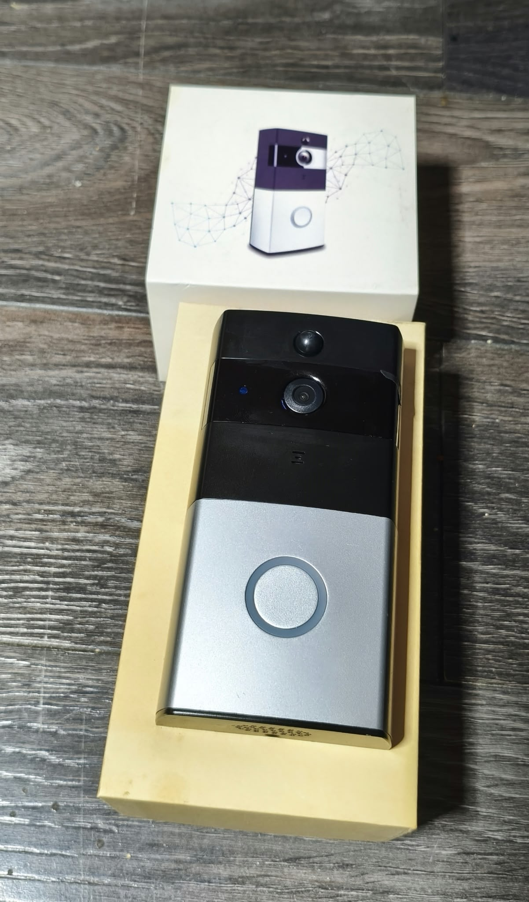

# ToSee-B Home Assistant

**Giving an old battery-powered video doorbell a second life.**

An open-source reverse-engineering project exploring how to use a legacy ToSee Wi-Fi video doorbell independently of its original mobile application's remote-video functionality.

The project currently supports event-driven communication with a tested doorbell, MQTT notifications, and live audio/video publishing over RTSP.

**Project status: experimental.** This is not yet a finished, plug-and-play Home Assistant integration.

## Tested Hardware



*The actual battery-powered Wi-Fi video doorbell used to develop and test this project. Photo by the project author.*

This unbranded device was originally paired using AP (Access Point) mode and operated through the legacy **ToSee** mobile application.

There is no clearly identifiable manufacturer or model number on the device.

**Compatibility warning:** Similar-looking doorbells may use different hardware, firmware, or communication protocols. Visual similarity does not guarantee compatibility.

## Why This Project Exists — Giving an Old Doorbell a Second Life

This project started with a simple problem: I had a perfectly functional battery-powered Wi-Fi video doorbell, but the software it depended on was becoming obsolete.

The only application that worked with my device was the original **ToSee** app, which had been removed from Google Play.

The application could still recognize and pair with the doorbell using AP (Access Point) mode. Live video worked when my phone was connected to the same local network as the camera.

However, remote access was a different story.

Whenever I switched to mobile data, the app would attempt to connect, and the doorbell's blue LED would blink, indicating some activity. Unfortunately, the live video stream never appeared.

Initially, I suspected a problem with my network configuration, particularly my pfSense firewall. I carefully investigated my network setup, but I couldn't identify anything that explained the issue.

Eventually, I decided to approach the problem differently.

**Instead of replacing a working device, I wanted to understand how it worked.**

I began investigating its network communication, reverse-engineering the protocol, and experimenting with ways to communicate with the doorbell independently of the original mobile application.

What started as an attempt to solve a remote-access problem became a much deeper exploration of the device's internal behaviour.

That work eventually led to **ToSee-B Home Assistant**, an open-source project that allows my previously app-dependent doorbell to work with a local Home Assistant-oriented setup.

Through my Home Assistant environment and its separately configured remote-access capabilities, I can access the system from outside my home network without relying on the original ToSee application's remote-video functionality.

### More Than Just an Integration

For me, this project is about more than connecting a camera to Home Assistant.

It's about understanding technology, solving real-world problems, and extending the useful life of hardware that might otherwise be discarded simply because its supporting software no longer works as expected.

**The doorbell got a second life — and I gained a much better understanding of how it works.**

Sometimes, the most interesting projects begin with something that refuses to work the way it should.

## Current Status

### Working in the Tested Environment

- Decryption and analysis of captured PPCS UDP communication.
- Reconstruction of H.264 video from captured packets.
- Offline video extraction and MP4 conversion using FFmpeg.
- Event-driven detection of doorbell activity.
- MQTT event publishing.
- Live H.264 video processing at 1280x720.
- G.711 A-law audio processing.
- Combined audio/video publishing to an RTSP stream through MediaMTX.
- Playback of the RTSP stream in VLC.
- Automated session handling following detected camera activity.

### Still Experimental or Incomplete

- Reliable live-stream presentation through the Home Assistant/go2rtc pipeline.
- General-purpose installation and configuration for other users.
- Compatibility with other ToSee devices or firmware versions.
- Long-term reliability across different network conditions.
- A complete native Home Assistant integration.

Remote access depends on the user's own Home Assistant and network configuration. This project does not expose a camera securely to the internet by itself.

## How It Works

The current experimental setup uses a Linux host to observe doorbell activity and manage communication with the device.

At a high level:

1. Doorbell activity is detected from network events.
2. The event service publishes relevant MQTT notifications.
3. A live audio/video session is started when appropriate.
4. Video and audio are processed and published through MediaMTX.
5. The resulting RTSP stream can be consumed by compatible clients.

The design takes the doorbell's battery-powered, event-driven behaviour into account rather than treating it as a permanently active IP camera.

## Project Components

Some of the main Python modules are:

- `event_service.py` — event-driven service.
- `event_listener.py` — event detection.
- `mqtt_events.py` — MQTT event publishing.
- `live.py` — live device communication.
- `video.py` and `video_reorder.py` — video processing.
- `audio.py` — audio processing.
- `av_publisher_v14.py` — experimental combined audio/video publishing.
- `crypto.py` — cryptographic operations used by the protocol implementation.

These modules are located under `src/tosee_b/`.

The repository also retains earlier experimental versions and offline decoding functionality.

## Documentation

- [Polish project documentation](docs/README_PL.md)
- [Detailed architecture guide in Polish](docs/ARCHITEKTURA_PL.md)

The architecture guide describes the project, its experimental environment, communication flow, and technical implementation in greater detail.

## Development and Testing

The project is developed and tested on Linux using Python.

Unit tests can be run from the repository root with:

```bash
PYTHONPATH=src .venv/bin/python -m unittest discover -s tests -p 'test_*.py' -q
```
A configured Python virtual environment and the relevant project dependencies are required.

This repository is experimental and should not currently be treated as a universal installation guide.
## Limitations
The implementation has been developed around one tested, unbranded ToSee-compatible battery doorbell.

Other devices, firmware versions, and network environments may behave differently.

Packet loss, session timing, and battery-saving behaviour can affect live video reliability.

The original application's remote-video failure was observed in the author's environment; its underlying cause was not conclusively established.
## Privacy and Security
Never publish private PCAP captures, camera recordings, passwords, network credentials, or unique device identifiers.

Do not expose the RTSP service or experimental communication endpoints directly to the public internet without appropriate security controls.
## License
GNU General Public License v3.

This project uses a PPCS lookup table originating from the GPLv3-licensed cloudedge-client project. See [NOTICE.md](NOTICE.md) for attribution.
## Disclaimer
This is an unofficial community reverse-engineering project, not affiliated with or endorsed by the device manufacturer or the developers of the original ToSee application.

Use it only with devices and networks you own or are authorized to access.
